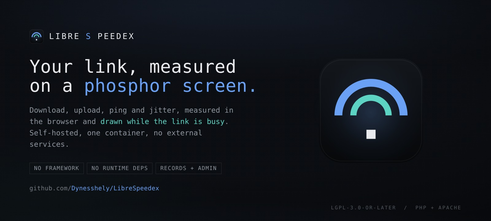
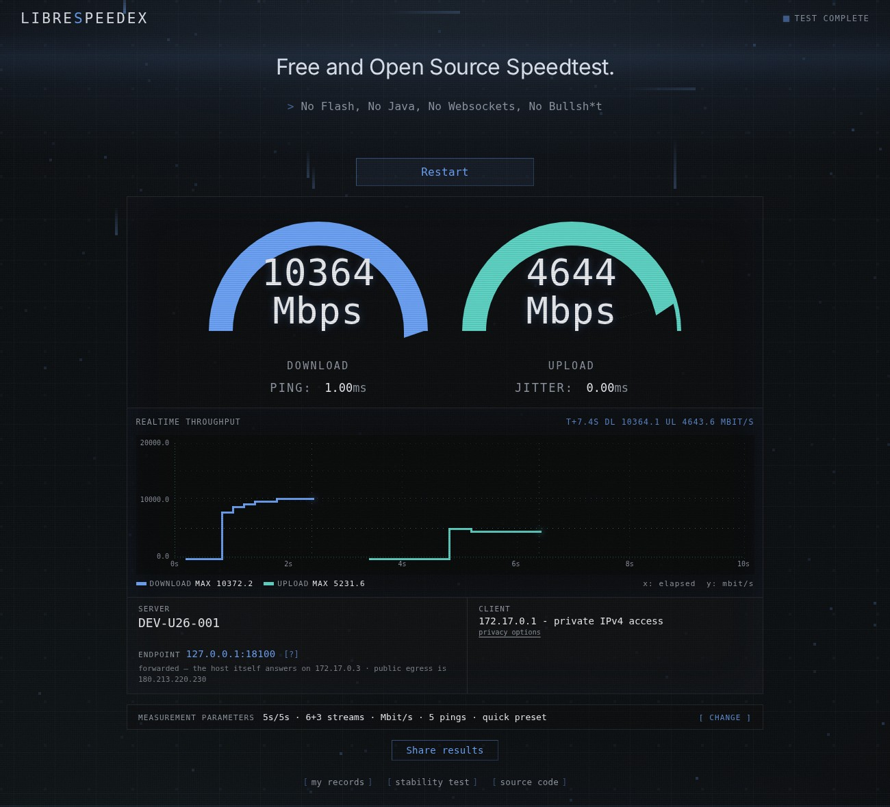
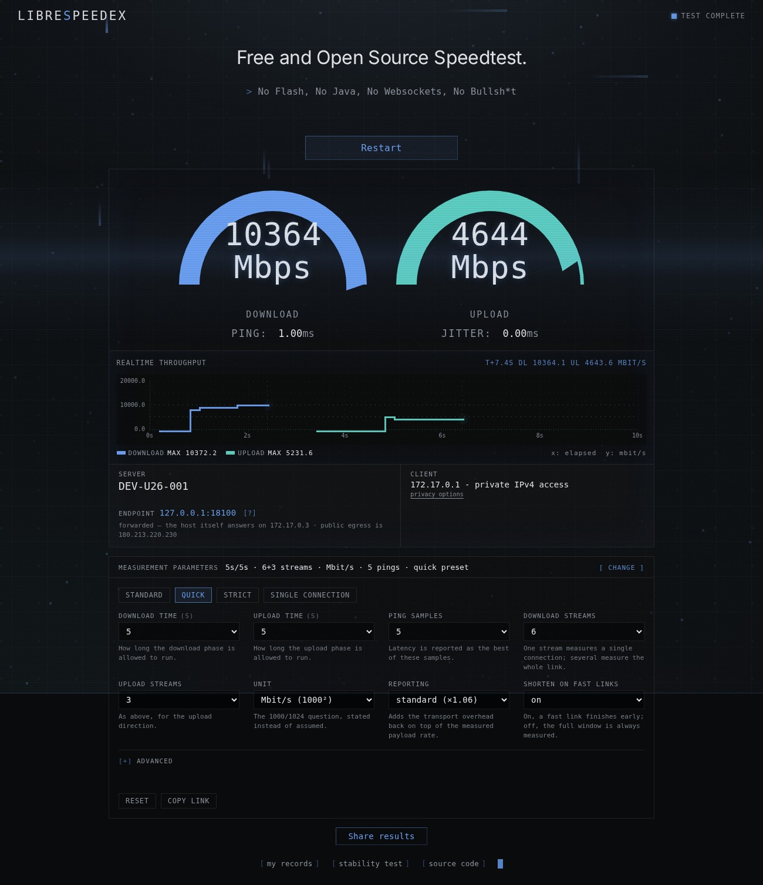
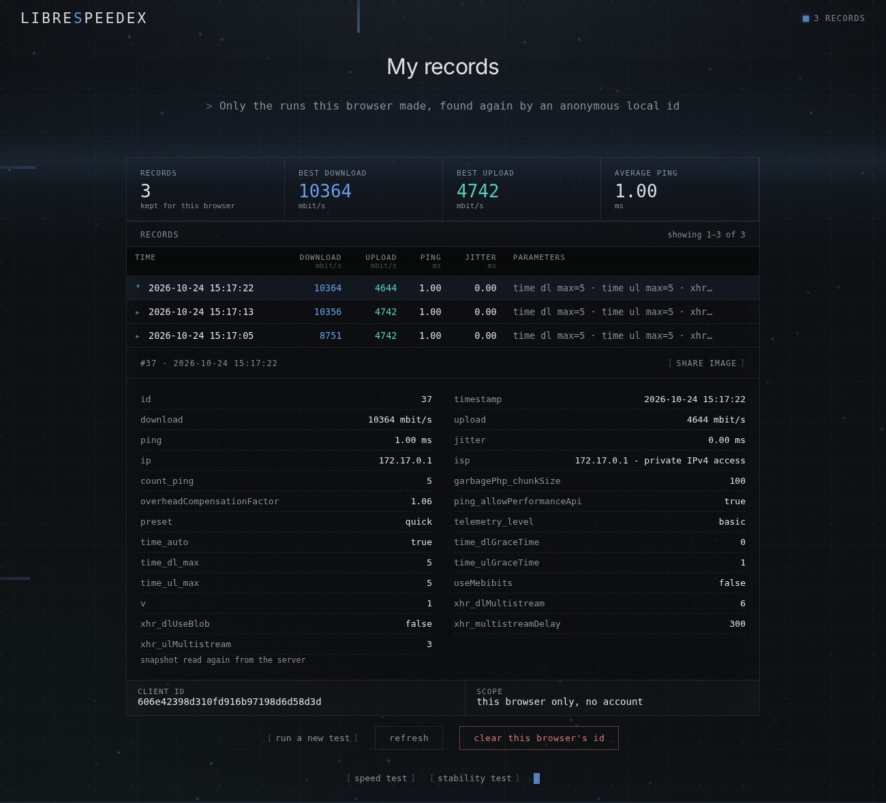
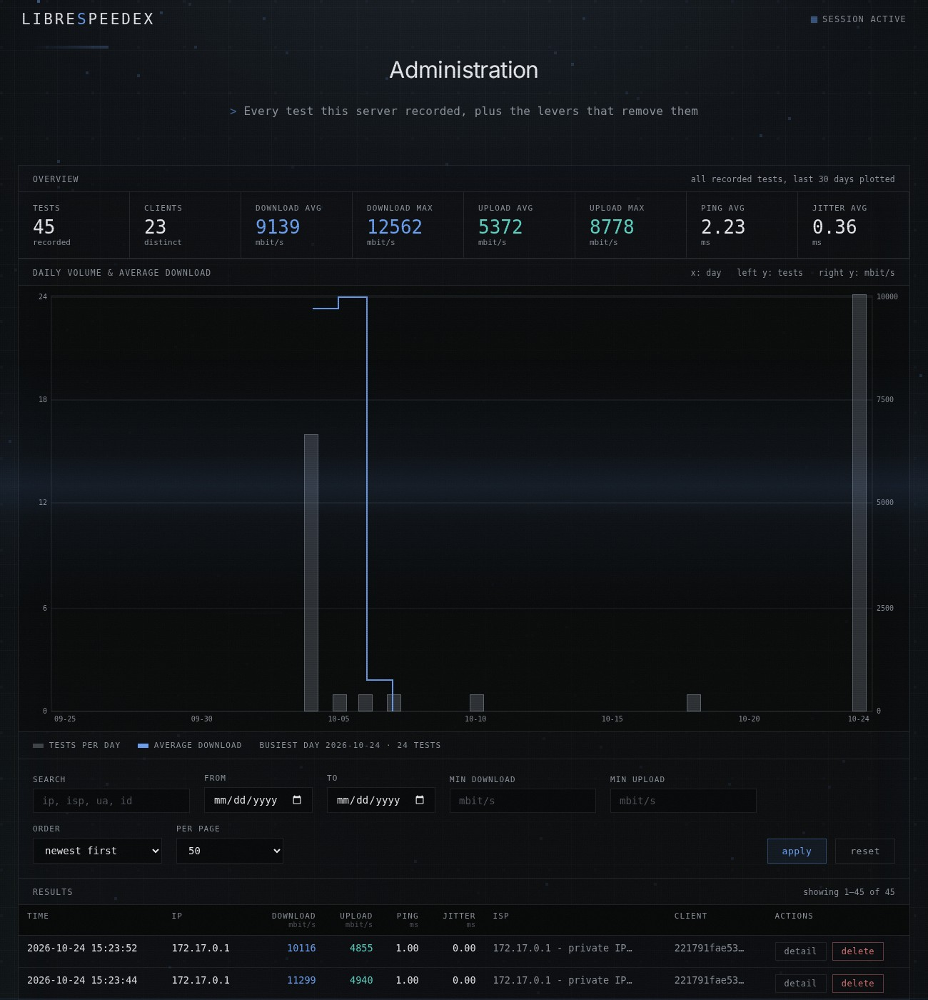
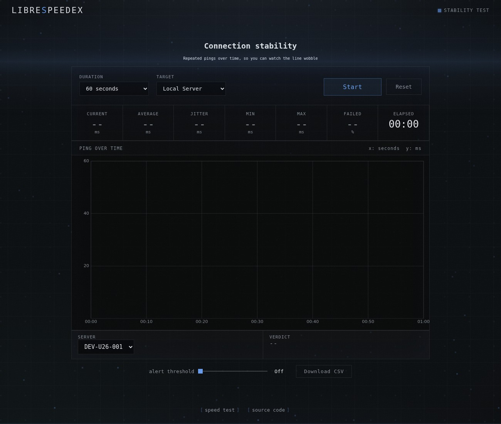
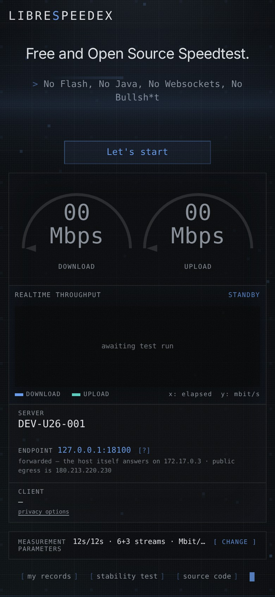

<p align="center">
  
</p>

<h1 align="center">LibreSpeedex</h1>

<p align="center">No Flash. No Java. No Websocket. No Bullsh*t.</p>

<p align="center">
  <a href="LICENSE"></a>
  <a href="doc.md"></a>
  <a href="DEVELOPMENT.md"></a>
</p>

A speed test you host yourself: download, upload, ping and jitter, measured in the
browser by a Web Worker and drawn while the link is busy, on a terminal that
never left 1983. One container, no framework, no external services.

It is a fork of [LibreSpeed](https://github.com/librespeed/speedtest) by Federico
Dossena. The measurement engine, the PHP backend and the results/telemetry layer
are upstream work and keep their attribution; this fork contributes the
interface and a set of things the interface made possible — records a visitor
can find again, an admin view, and the knobs behind a measurement.



## What this fork adds

| | |
|---|---|
| **A terminal screen** | One design instead of three. Near-black neutral surfaces, a monospaced readout, scanlines and a pixel backdrop whose density, speed and hue follow the measurement. Colour means *this is measured*: blue for download, teal for upload, amber only while aborting. |
| **The link, drawn live** | A throughput plot under the gauges — x: elapsed seconds, y: Mbit/s — quantised to the pixel grid with peak lines, so the shape of the run is visible and not just its end. |
| **The dials, exposed** | Presets and individual parameters for duration, ping samples, stream counts, unit, overhead reporting and warmup. The choice lives in the URL (`?p=…`) and travels with the result as a snapshot. |
| **Where the traffic goes** | The status strip names the address the browser actually connected to, plus the node's own interface and public address — the three things that get confused for each other behind NAT and Docker. |
| **Records without accounts** | A visitor sees the runs this browser made, keyed by an anonymous local id rather than an IP address, because an address is shared by everyone behind one NAT. |
| **An admin view** | Totals, a 30-day chart, filters, per-run detail, deletion, purge and CSV export, in the same design language as the pages it describes. |
| **A backend with a policy** | Forwarding headers are believed only from configured proxies, the transfer endpoint is capped per request and per address, and telemetry writes are rate limited and swept by age. |

## Features

* Download, upload, ping and jitter, with ISP and distance (optional)
* Multiple Points of Test (optional)
* Telemetry, results sharing and a shareable result image (optional)
* Connection stability test: repeated pings, latency chart, loss tracking,
  threshold alerts and CSV export
* Measurement parameters with presets, stored alongside every result
* Per-browser records page and an admin panel
* Works in every current browser, on desktop and mobile

## Screenshots

**Measurement parameters.** Presets for the common cases, and the individual
dials underneath for the ones they do not cover. Advanced settings — block size,
warmup windows, stream stagger, disk-backed streaming, a per-run opt-out of
storing the result — stay folded away.



**My records.** The runs this browser made, found by an anonymous id it keeps
locally. The parameter snapshot is part of the record, so an old number can still
be read in context. Nothing here needs an account, and clearing the id explains
what it does and does not delete.



**Administration.** Every recorded test, with the levers that remove them:
`results/admin.html`, behind the password in the server configuration.



**Connection stability**, in the same language:



<p align="center">
  
</p>

## Quick start

### Docker

```sh
docker build -t librespeedex .
docker run --rm -p 8080:8080 \
  -e PASSWORD='choose-something-real' \
  -v "$PWD/db:/database" \
  librespeedex
```

Then open <http://localhost:8080>. Records are off until you ask for them: add
`-e TELEMETRY=true`, at which point <http://localhost:8080/results/admin.html>
and <http://localhost:8080/my-results.html> come alive. The volume keeps the
SQLite file outside the container, which matters because the container is
disposable.

See [doc_docker.md](doc_docker.md) for the full list of environment variables —
frontend/backend/dual modes, MySQL or PostgreSQL instead of SQLite, and the
reverse-proxy settings.

### Plain PHP

1. Copy the project into your web root, keeping the layout: `frontend/` is
   loaded as a directory, not unpacked.
2. Make sure the web server can read it, and that PHP can write wherever the
   SQLite database will live if you enable telemetry.
3. Open `index.html` from that directory.

`results/telemetry_settings.php` is the file to edit for a non-Docker install:
the database, the admin password, IP redaction and retention.

## Configuration

### Environment variables worth knowing

| Variable | Default | What it does |
|---|---|---|
| `MODE` | `standalone` | `standalone`, `frontend`, `backend` or `dual` |
| `TITLE` / `TAGLINE` | *(empty)* | Replace the page title and heading; empty keeps the ones in the markup |
| `TELEMETRY` | `false` | Store results at all |
| `PASSWORD` | `password` | Admin password. The panel refuses every request until this is changed |
| `GDPR_EMAIL` | *(empty)* | Deletion contact shown in the privacy policy |
| `TRUSTED_PROXIES` | *(empty)* | Comma separated addresses/CIDRs whose forwarding headers are believed |
| `GARBAGE_MAX_CHUNK_MB` | `256` | Largest single download request |
| `GARBAGE_MAX_CONCURRENT`<br>`GARBAGE_MAX_CONCURRENT_PER_IP` | `64`<br>`16` | Concurrent download streams, overall and per address |
| `SERVER_NODE_NAME` | `local` | Label for the node, above its endpoint address |
| `SERVER_INFO_PUBLIC_IP` | `true` | Allow the node to look up its own public egress, cached for an hour |
| `TELEMETRY_RETENTION_DAYS` | `90` | Records older than this are swept during writes; `0` keeps them |
| `TELEMETRY_RATE_LIMIT`<br>`TELEMETRY_RATE_LIMIT_IP` | `60`<br>`240` | Stored results per hour, per browser id and per address |
| `REDACT_IP_ADDRESSES` | `false` | Store `0.0.0.0` and scrub addresses out of logs and ISP data |

Everything the container can set is also a variable in
[`backend/backend_settings.php`](backend/backend_settings.php) and
[`results/telemetry_settings.php`](results/telemetry_settings.php), which is
where a plain PHP install sets it.

### Behind a proxy

Forwarding headers are only read when the request genuinely arrives from an
address on `$trusted_proxies`. From anywhere else the socket peer wins, because
`X-Forwarded-For` can be set by anyone — and the address is now what a stored
result is judged against. Set it to your proxy, for example
`-e TRUSTED_PROXIES=172.16.0.0/12`.

### The measurement dials

`frontend/javascript/test-params.js` owns the panel. Four presets — standard,
quick, strict, single connection — cover the usual intents; the individual
parameters are open underneath. What is deliberately *not* adjustable is where
the traffic goes (`url_dl`, `url_ul`, `url_ping`): a visitor who can retarget
those turns the server into a reflector. See
[doc.md](doc.md#test-parameters) for the full contract.

### Records and administration

* `my-results.html` — the visitor's own runs. Grouped by an anonymous id the
  browser generates and keeps in `localStorage`, **not** by IP address: one
  address is shared by everyone behind a NAT, so an IP-scoped list would show a
  visitor other people's tests. Clearing the id is offered and explained.
* `results/admin.html` — everything recorded, with filters, per-run detail, row
  deletion, purge by date or in full behind typed confirmation, and CSV export.
  It talks to `results/admin_api.php`, which is session authenticated with
  `PASSWORD` and requires a CSRF token for anything that changes state.
* The older `results/stats.php` and the share-image generator
  `results/index.php` are unchanged and still work.

## How the measurement works

The browser pulls incompressible random data from `backend/garbage.php` over
several parallel streams and pushes random blobs at `backend/empty.php`, timing
the bytes itself; latency is the best of a set of empty round trips, with jitter
as the weighted difference between consecutive ones. A grace window at the start
of each direction is discarded so the result is not biased by an empty TCP
window or unfilled send buffers. Nothing is measured on the server — it only
serves bytes — so the number describes the path from *your* browser to *this*
server.

[doc.md](doc.md) has the parameters, the protocol and the implementation notes
in full.

## Compatible clients

Because the backend speaks the LibreSpeed protocol, the existing clients work
against it: [Android](https://github.com/librespeed/speedtest-android),
[CLI](https://github.com/librespeed/speedtest-cli),
[.NET](https://github.com/Memphizzz/LibreSpeed.NET),
[Go](https://github.com/librespeed/speedtest-go) and
[Rust](https://github.com/librespeed/speedtest-rust) backends are maintained
upstream. This fork does not vendor them.

## Development

```sh
npm install          # Playwright, Tailwind CLI, ESLint, Prettier
npm run css          # rebuild frontend/styling/tailwind.css from the markup
npm run lint         # eslint, including frontend/javascript/
```

`frontend/styling/tailwind.css` is generated and committed: after changing
markup, run `npm run css` before building the image, or the new classes will not
exist. [DEVELOPMENT.md](DEVELOPMENT.md) covers the rest — the stylesheet
pipeline, the palette, and how to reskin without fighting it.

Two test harnesses live in the repository:

* [`tests/telemetry/`](tests/telemetry/) — the data layer against real SQLite:
  schema migration, per-client isolation, limits, retention.
* [`tests/pages/`](tests/pages/) — a stub server plus probes for the records and
  admin pages, which otherwise need PHP to render.

The Playwright end-to-end suite is in `tests/e2e/` and needs the docker-compose
harness described in [tests/](tests/).

## Server requirements

* A web server with PHP 7.0 or newer (the Docker image ships PHP 8 with Apache)
* MySQL, MariaDB, PostgreSQL, SQL Server or SQLite, if you want records
* A fast connection, and a hosting provider who does not mind you using it

## Compatibility

Current versions of Chrome, Edge, Firefox and Safari, on desktop and mobile. The
interface uses CSS nesting, custom properties and canvas; there is no transpiler
and no polyfill.

## Attribution

LibreSpeedex is a fork of [LibreSpeed](https://github.com/librespeed/speedtest)
by [Federico Dossena](https://fdossena.com). Upstream work retained here
includes the measurement engine (`speedtest.js`, `speedtest_worker.js`,
`stability_worker.js`), the PHP backend, the telemetry and results layer, the
documentation in [doc.md](doc.md) and [doc_docker.md](doc_docker.md), and the
server lists, which contain third-party hosts rather than anything of ours.

The interface — palette, screen, console layout, plots, parameter panel, records
and admin pages — is this fork's contribution, under the same licence.

## Licence

Copyright (C) 2016-2024 Federico Dossena
Copyright (C) 2026 the LibreSpeedex contributors

This program is free software: you can redistribute it and/or modify it under
the terms of the GNU Lesser General Public License as published by the Free
Software Foundation, either version 3 of the License, or (at your option) any
later version.

This program is distributed in the hope that it will be useful, but WITHOUT ANY
WARRANTY; without even the implied warranty of MERCHANTABILITY or FITNESS FOR A
PARTICULAR PURPOSE. See the GNU General Public License for more details.

You should have received a copy of the GNU Lesser General Public License along
with this program. If not, see <https://www.gnu.org/licenses/lgpl>.
